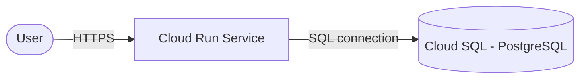

# GCP Cloud Run + Cloud SQL (Terraform)

> Serverless container on Cloud Run backed by a managed Cloud SQL (PostgreSQL) database — provisioned with Terraform.
> **Author:** Muhammad Ahmad · **IaC:** Terraform · **Cloud:** GCP


---

## 📌 Overview

- **Cloud Run** runs the container, scales to zero, and is publicly reachable over HTTPS.
- **Cloud SQL (PostgreSQL 15)** provides the managed database, with an app database and user.
- The service receives the Cloud SQL **connection name** and database name via environment variables.

## 🏗️ Architecture



## 🚀 Deploy

```bash
cd terraform
gcloud auth application-default login
export TF_VAR_db_password='YourStr0ngPassw0rd'
terraform init
terraform apply -var="project_id=YOUR_PROJECT_ID"

terraform output cloud_run_url
```

## 🧹 Clean up

```bash
terraform destroy -var="project_id=YOUR_PROJECT_ID"
```

## 💰 Cost note

Cloud Run scales to zero (pay per request). Cloud SQL `db-f1-micro` bills while running — stop/destroy when idle.

## 🔐 Production hardening (next steps)

- Connect privately via a **Serverless VPC Access** connector + private IP.
- Store the DB password in **Secret Manager**.
- Give Cloud Run a **dedicated service account** with least privilege.

---

*Built and maintained by **Muhammad Ahmad**.*
