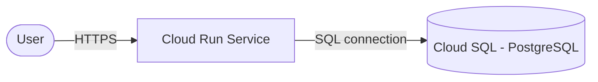

# Architecture Diagram — GCP Cloud Run + Cloud SQL

## Lucid diagram

- **Master Lucid document (all 30 diagrams, icon style):** https://lucid.app/lucidchart/3da75ce3-ea66-4296-81b3-00d20a60435b/edit
- This project is **page 22** of that document.

## Lucid prompt (reusable)

```
Create a GCP architecture diagram titled "GCP Cloud Run + Cloud SQL".
A User connects over HTTPS to a Cloud Run service, which connects to a Cloud SQL
(PostgreSQL) database using the instance connection. Label the arrows. Clean,
professional Google Cloud colors.
```

## Mermaid source


